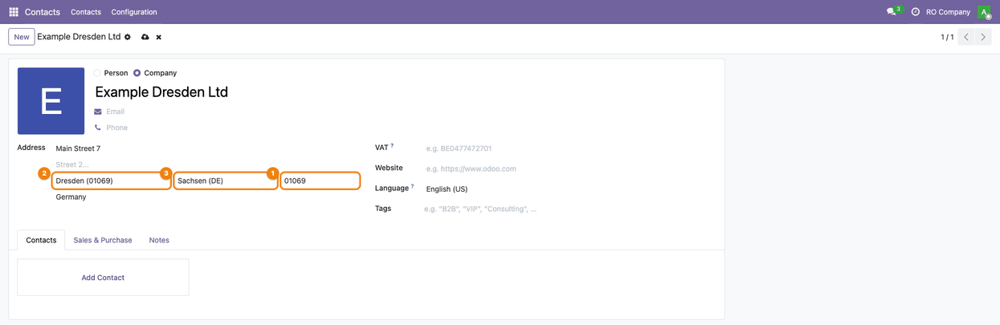
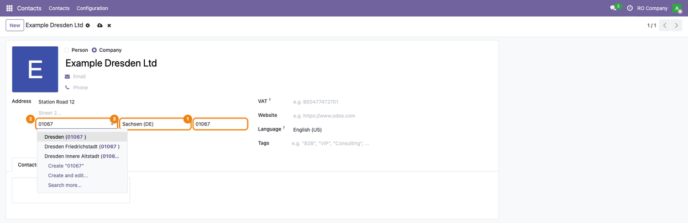
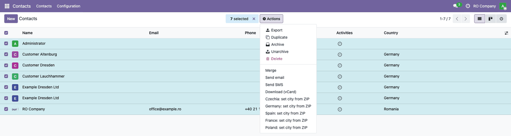
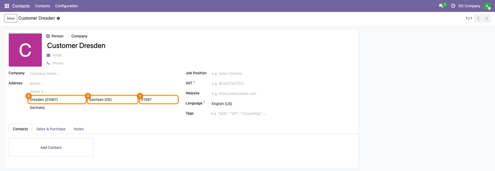

=======================
Germany - City from ZIP
=======================

..
   !!!!!!!!!!!!!!!!!!!!!!!!!!!!!!!!!!!!!!!!!!!!!!!!!!!!
   !! This file is generated by oca-gen-addon-readme !!
   !! changes will be overwritten.                   !!
   !!!!!!!!!!!!!!!!!!!!!!!!!!!!!!!!!!!!!!!!!!!!!!!!!!!!
   !! source digest: sha256:bee9dd66f471e4a00164de8d162772188e87fa74f877f628a49ef1fa5e3a6746
   !!!!!!!!!!!!!!!!!!!!!!!!!!!!!!!!!!!!!!!!!!!!!!!!!!!!

.. |badge1| image:: https://img.shields.io/badge/maturity-Beta-yellow.png
    :target: https://odoo-community.org/page/development-status
    :alt: Beta
.. |badge2| image:: https://img.shields.io/badge/license-LGPL--3-blue.png
    :target: http://www.gnu.org/licenses/lgpl-3.0-standalone.html
    :alt: License: LGPL-3
.. |badge3| image:: https://img.shields.io/badge/github-dhongu%2Fl10n--germany-lightgray.png?logo=github
    :target: https://github.com/dhongu/l10n-germany/tree/20.0/l10n_de_zip
    :alt: dhongu/l10n-germany

|badge1| |badge2| |badge3|

Loads the German localities (Orte) with their postal code and region,
and fills in the city and the region of German addresses from the postal
code.

- Ships the list of German localities with their postal code, linked to
  the regions of Germany. The data comes from
  `GeoNames <https://www.geonames.org>`__ (Creative Commons Attribution
  4.0).
- Germany is set to *enforce cities*: the city of a German address is
  chosen from the list.
- On the contact form, typing the postal code (Postleitzahl) of a German
  address sets the city and the region. A postal code shared by several
  localities sets only the region; the city name, when it matches one of
  them (without accents and case), picks the locality.
- The action *Germany: set city from ZIP* on contacts links the German
  contacts to the city of their postal code and fills in the region.
- At install, the German contacts are linked: directly on a small
  database, by the scheduled action *Germany: link contacts to the city
  of their ZIP* in batches on a large one (it deactivates itself when
  done).
- Every form that runs the postal code rules of the contact (for example
  the delivery details of an AWB) gets the region filled in, so the
  shipment can be sent to Germany without looking it up by hand.

**Table of contents**

.. contents::
   :local:

Usage
=====

1. As an administrator, open **Contacts → Configuration → Localization →
   Cities** and search for a postal code: the German localities of that
   postal code are listed with their federal state.

   |Cities list filtered on the postal code 01067: the localities
   Dresden, Dresden Friedrichstadt, Dresden Innere Altstadt, all of the
   state Sachsen (DE)|

2. Open a German contact and type the postal code in the address: the
   city and the region are filled in.

   |Contact in Germany: the postal code 01069 fills in the city Dresden
   and the state Sachsen (DE)|

3. When the postal code is shared by several localities, only the region
   is filled in; choose the city from the list (type the postal code or
   the name in the city field).

   |Contact in Germany: the postal code 01067 fills in the state Sachsen
   (DE); the city field lists the localities of 01067|

4. To complete existing or imported contacts, select them in the list
   and run *Actions → Germany: set city from ZIP*.

   |Contacts list with German contacts selected and the Actions menu
   open on Germany: set city from ZIP|

   |Contact Customer Dresden after the action: ZIP 01067, city Dresden
   (01067) and state Sachsen (DE)|

.. |Cities list filtered on the postal code 01067: the localities Dresden, Dresden Friedrichstadt, Dresden Innere Altstadt, all of the state Sachsen (DE)| image:: https://raw.githubusercontent.com/dhongu/l10n-germany/20.0/l10n_de_zip/static/description/en/01_lista_localitati_cap.png

Changelog
=========

20.0.1.0.0 (2026-11-16)
-----------------------

**Changed**

- Migration to Odoo 20: the PostgreSQL codes to retry are defined in the
  module (``odoo.service.model.PG_CONCURRENCY_ERRORS_TO_RETRY`` was
  removed) and the relink position uses ``ir.config_parameter``
  ``get_int`` / ``set_int``.

19.0.1.0.0 (2026-11-16)
-----------------------

**Added**

- German localities with postal code and region, from GeoNames.
- City and region filled in from the postal code on German addresses;
  action and scheduled action to link the existing contacts.
- Consultant sheet (readme/FISA_CONSULTANT.md) and screenshots, in
  English.

Bug Tracker
===========

Bugs are tracked on `Terrabit Issues <https://www.terrabit.ro/helpdesk>`_.
In case of trouble, please check there if your issue has already been reported.

Do not contact contributors directly about support or help with technical issues.

Credits
=======

Authors
-------

* Terrabit

Maintainers
-----------

.. |maintainer-dhongu| image:: https://github.com/dhongu.png?size=40px
    :target: https://github.com/dhongu
    :alt: dhongu

Current maintainer:

|maintainer-dhongu| 

This module is part of the `dhongu/l10n-germany <https://github.com/dhongu/l10n-germany/tree/20.0/l10n_de_zip>`_ project on GitHub.

You are welcome to contribute.